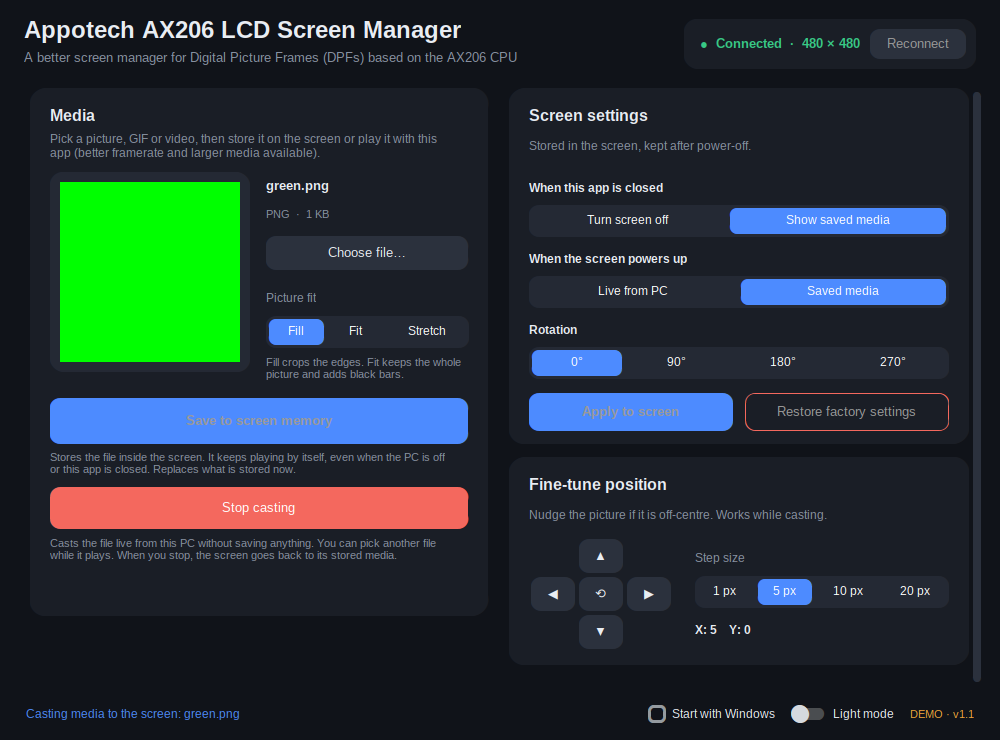

# Appotech AX206 LCD Screen Manager

A modern Windows GUI replacement for `WebBrowserV23Port2020.exe` (also known as **2.1mianqu / 独立屏免驱驱动 / MianQ 2.1**) for managing compatible USB LCD photo-frame displays. Play media directly from your PC, or save it to the screen so it can keep playing when your computer is off. This is NOT the official software from [TURZX](https://www.turzx.com/) and it's not affiliated with them in any way whatsoever. This software replaces the need for the original 2.1-inch round IPS LCD software that the vendor recommends. Wishful thinking, but I wish any search for WebBrowserV23Port2020 would redirect here, since it is the app that comes bundled with the aliexpress purchases and what most people would use, any search is kinda useless because it thinks the software/driver is a bunch of other stuff.

<p align="center">
  <a href="https://github.com/caioklein/AX206-LCD-Screen/releases/tag/v1.1.0"></a>
  <a href="https://github.com/caioklein/AX206-LCD-Screen/blob/main/LICENSE"></a>
</p>

## Table of contents

- [Preview](#preview)
- [Download and run](#download-and-run)
- [Why this exists](#why-this-exists)
- [Features](#features)
- [Troubleshooting](#troubleshooting)
- [Build from source](#build-from-source)
- [Related projects](#related-projects)
- [License](#license)

## Preview



## Download and run

Pre-requirements: USB Driver [WinUSB (v6.1.7600.16385)](https://zadig.akeo.ie/) just click on Install WCID Driver

**[Download Appotech AX206 LCD Screen Manager v1.1.0](https://github.com/caioklein/AX206-LCD-Screen/releases/tag/v1.1.0)**

1. Open the [v1.1.0 release page](https://github.com/caioklein/AX206-LCD-Screen/releases/tag/v1.1.0).
2. Download the Windows executable from **Assets**.
3. Connect your LCD screen over USB and run `Appotech AX206 LCD Screen Manager.exe`.

The release is a **standalone executable**: there is no separate installation step, and FFmpeg is bundled. The app stores its settings in `%APPDATA%\AppotechLCD\settings.ini`.

> **Connection note:** The app has been tested with the 2.1-inch cooler LCD using USB ID `2A55:9990`. The screen needs a compatible USB driver (WinUSB/libusb-compatible). If the app cannot find it, see [Troubleshooting](#troubleshooting) below.

## Why this exists

I've had my own round display that sits on my watercooler for a long time and always dreaded using the original program that the vendor has, which is the only program for it by the way. The program was very badly translated and EXTREMELY resource heavy, it somehow used more CPU than some games and that always pissed me off. After some research, there were no other solutions for windows and only one project that fixed this issue for linux, so I tried my hand on this whole decompilation by AI thing and came up with this little program that strips the useless stuff from the original and give it what matters: putting silly gifs on my little watercooler lcd display

## Features

### Play media your way

- **Save to screen memory** — store a picture, GIF, or video on the display. The saved content can keep playing without the PC or app running.
- **Cast from your PC** — play media live without writing it to the screen's limited storage. Switch to another file while casting; the stream continues with the new selection. Select **Stop casting** to return to the screen's saved media.
- **Broad media input** — choose images (`PNG`, `JPG`, `BMP`), GIFs, or videos such as `AVI`, `MP4`, `MKV`, `MOV`, and `WEBM`.
- **Picture fit modes** — **Fill** crops to fill the screen, **Fit** preserves the full image with bars if needed, and **Stretch** scales to the screen dimensions.

### Control the display

- **Rotation** — set the screen to `0°`, `90°`, `180°`, or `270°`.
- **Fine-tune position** — nudge the image up, down, left, or right by `1`, `5`, `10`, or `20` pixels, or recenter it. Position controls are available while casting.
- **On close** — choose whether the display turns off or returns to its saved media when the app closes or casting stops.
- **On power-up** — choose whether the display waits for a live PC stream or starts playing saved media.
- **Apply settings** — write display settings to the screen, or restore the factory defaults.
- **Start with Windows** — configure automatic startup from the app.

## Troubleshooting

### The screen is not found

1. Check the USB connection, including the internal motherboard USB header if that is how your screen is connected.
2. Close the original vendor software and any other program that may be using the screen, then select **Reconnect**.
3. Confirm that the device has a compatible USB driver. If Windows assigned an incompatible driver, use [Zadig](https://zadig.akeo.ie/) to bind a compatible **WinUSB** driver to the correct device.

There is also the possibility that the program is not able to detect other USB slots that are not the one I used to build it since I didn't bother unplugging the screen to try another. If you have this issue, raise an issue with your USB ID, meanwhile you can get your favorite AI agent to just swap the USB ID and compile the .exe yourself for a personalized program!

### The display does not return to saved media after casting

Open the app settings, set **When this app is closed** to **Show saved media**, and click **Apply to screen**. Stop casting before closing the app if you want to return to the stored content immediately.

### Diagnostics

For development builds, run the CLI with tracing enabled to record USB traffic:

```powershell
python cli.py --trace info
```

When tracing is enabled in the executable, the USB log is written to `%APPDATA%\AppotechLCD\usb_trace.log`.

## Build from source

The prebuilt release is recommended for regular use. To run or build the Python source instead, install the dependencies and use the included scripts:

```powershell
pip install -r requirements.txt
python app.py
python cli.py info
python test_protocol.py
build_exe.bat
```

- `app.py` — desktop GUI.
- `cli.py` — command-line interface.
- `lcdproto.py` — USB protocol implementation.
- `core.py` — settings and application actions.
- `media.py` — image conversion, JPEG handling, and video transcoding.
- `simulator.py` — simulated device for protocol testing without hardware.

To preview the interface without connecting a screen, run the executable with `--demo`:

```powershell
"Appotech AX206 LCD Screen Manager.exe" --demo
```

## Related projects

- [dpf-ax on SourceForge](https://sourceforge.net/projects/dpf-ax/)
- [dpf-ax on GitHub](https://github.com/dreamlayers/dpf-ax)

Appotech AX206 LCD Screen Manager focuses on a straightforward Windows GUI for the 2.1-inch USB screen and the workflow previously handled by the vendor utility.

## License

This project is licensed under the [GNU General Public License v3.0](LICENSE).
